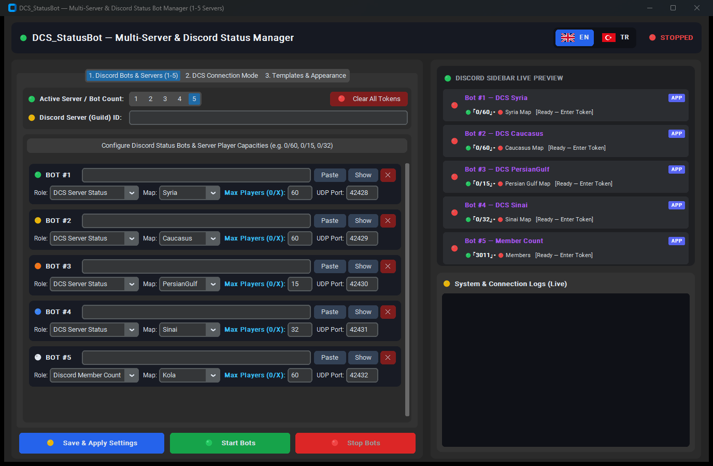
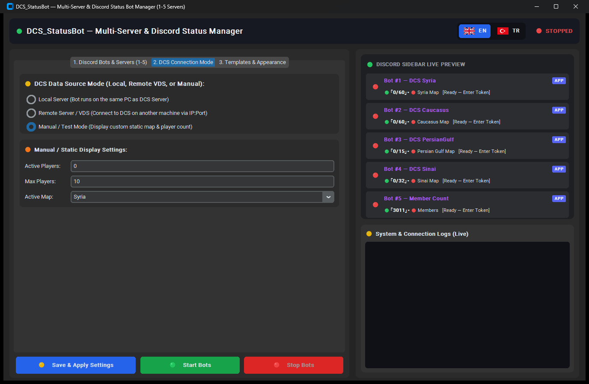
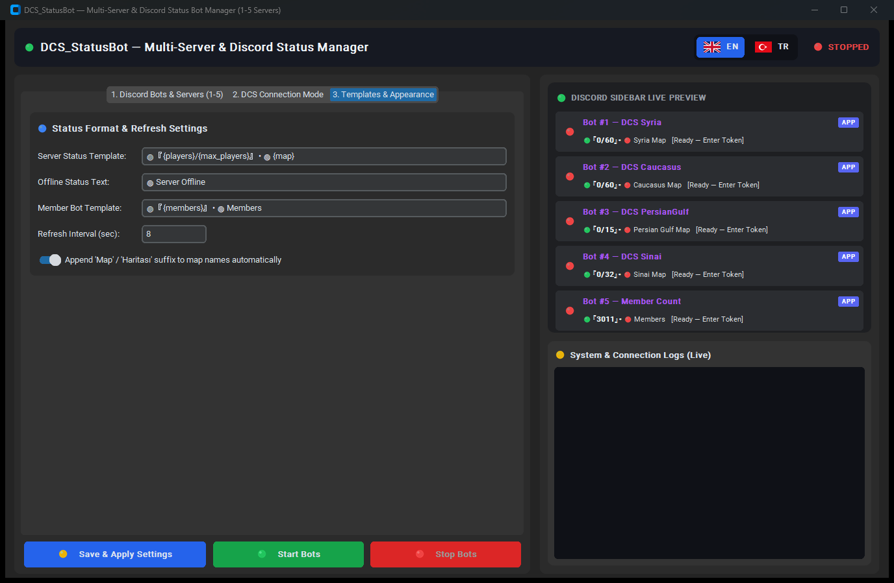
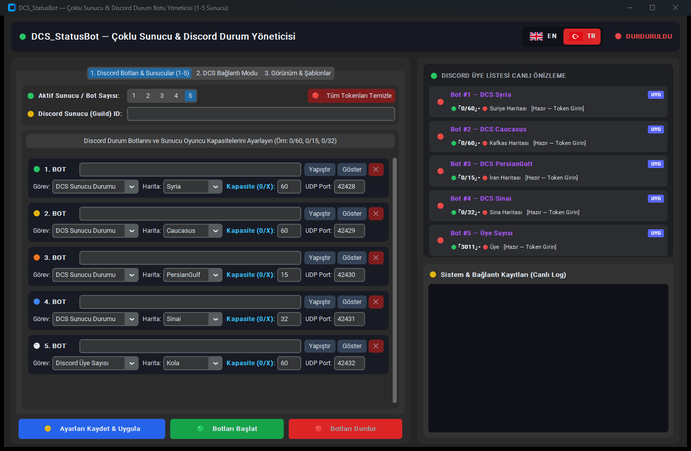
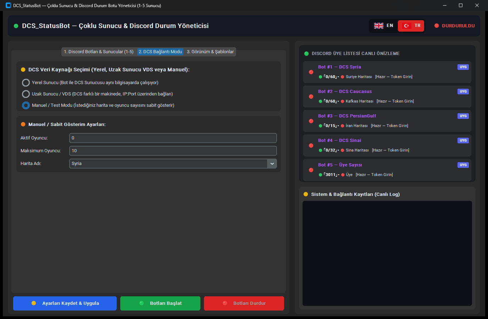
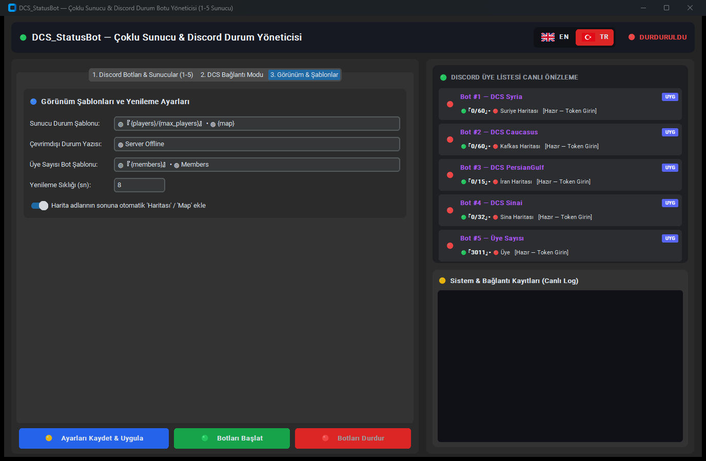

<div align="center">

# ✈️ DCS_StatusBot

**Multi-Server & Discord Live Member-List Status Bot Manager (1 to 5 Servers)**  
**Çoklu Sunucu ve Discord Üye Listesi Canlı Durum Botu Yöneticisi (1 – 5 Sunucu)**

[](#)
[](#)
[-ea580c?style=for-the-badge)](#)
[](#)

<br/>

<a href="#-english-documentation"> <b>ENGLISH DOCUMENTATION (Default)</b></a>
&nbsp;&nbsp;&nbsp;│&nbsp;&nbsp;&nbsp;
<a href="#-t%C3%BCrk%C3%A7e-dok%C3%BCmantasyon"> <b>TÜRKÇE DOKÜMANTASYON (Aşağıda)</b></a>

</div>

---

#  ENGLISH DOCUMENTATION

## 🌟 1. Overview & Key Features

**`DCS_StatusBot`** is an all-in-one desktop and console management suite that displays live **DCS World Dedicated Server** telemetry (active players, custom max player capacity such as `0/60`, `0/15`, or `0/32`, and active theater map) plus **Discord Server Member Count** directly inside your Discord server's right-hand member list:

* 🟢 **`🟢『12/60』• 🔴 Syria Map`** *(Server #1 — Custom `0/60` capacity)*
* 🟡 **`🟢『8/60』• 🔴 Caucasus Map`** *(Server #2 — Custom `0/60` capacity)*
* 🟠 **`🟢『4/15』• 🔴 Persian Gulf Map`** *(Server #3 — Custom `0/15` capacity)*
* 🔵 **`🟢『19/32』• 🔴 Sinai Map`** *(Server #4 — Custom `0/32` capacity)*
* ⚪ **`🟢『3011』• 🔴 Members`** *(Bot #5 — Live Discord Member Counter)*

### Core Highlights
1. **Single Master Installer (`run.bat`)**: Automatically verifies Python, installs required packages (`discord.py`, `aiohttp`, `customtkinter`, `Pillow`), creates default configuration files, injects the lightweight DCS Lua Hook into your `Saved Games\DCS*\Scripts\Hooks` folders, and launches the interactive command center.
2. **Configurable Server & Bot Count (`1` to `5` Servers)**: Choose `1`, `2`, `3`, `4`, or `5` active servers/bots via the `[ 1 | 2 | 3 | 4 | 5 ]` selector in the GUI or console wizard.
3. **Custom Per-Server Player Capacity (`0/X`)**: Each bot slot has its own **Max Players (`0/X`)** field (`0/60`, `0/15`, `0/32`, etc.). It updates both the Discord status display and the `maxPlayers` value inside each server's `serverSettings.lua`.
4. **Local PC or Remote VDS Support**: Works on the same PC as your DCS Server (Local JSON file) or across remote VDS servers via UDP telemetry (`IP:Port`).
5. **Bilingual Interface (`EN` / `TR`)**: Starts in **English** by default and switches between English and Turkish with a single click on the top-right flag buttons.

---

## 🖥️ 2. Tab 1: Discord Bots, Server Count (`1–5`) & Player Capacities (`0/60`, `0/15`)

<div align="center">

</div>

### Step-by-Step Field Guide (Tab 1)

| UI Control / Field | Description & How to Configure |
| :--- | :--- |
| **🟢 Active Server / Bot Count (`1–5`)** | Click `1`, `2`, `3`, `4`, or `5` to set how many Discord status bots and servers you want to run. Both the left configuration cards and the right **Discord Sidebar Live Preview** adjust immediately. |
| **🟡 Discord Server (Guild) ID** | Right-click your Discord server icon -> **Copy Server ID** and paste it here *(requires Developer Mode enabled in Discord Settings -> Advanced)*. If left empty, the bot detects your server automatically. |
| **🔑 Bot Token (`BOT #1` – `BOT #5`)** | Paste each bot's token from the [Discord Developer Portal](https://discord.com/developers/applications) using the **`Paste`** button. Use **`Show`** to view the token or **`✕`** to clear it. Tokens are stored locally in a Windows ACL-locked `.env` file. |
| **🎭 Role** | Select **`DCS Server Status`** to display live DCS players/map, or **`Discord Member Count`** to display your Discord server's total member count. |
| **🗺️ Map** | Choose the server's active map (`Syria`, `Caucasus`, `PersianGulf`, `Sinai`, `Kola`, `MarianaIslands`, `Normandy`, `Nevada`, `SouthAtlantic`, `Afghanistan`, `Iraq`). |
| **👥 Max Players (`0/X`)** | Enter the server's player capacity (e.g., `60` for `0/60`, `15` for `0/15`, `32` for `0/32`). Updating this value immediately updates the right-side Discord Live Preview (`🟢『0/15』• 🔴 Persian Gulf Map`). |
| **🔌 UDP Port** | Set the UDP telemetry port for each DCS server (`42428` for Bot #1, `42429` for Bot #2, `42430` for Bot #3, `42431` for Bot #4, `42432` for Bot #5). |

---

## 🔌 3. Tab 2: DCS Connection Modes (Local Server, Remote VDS & Manual Test)

<div align="center">

</div>

### Choosing Your Connection Mode
* **🟢 1. Local Server (Bot and DCS Server run on the same PC)**:
  1. Select your `Saved Games\DCS` (or `Saved Games\DCS.dcs_server`) folder from the dropdown list or click **`Browse...`**.
  2. Click **`Auto-Install / Update DCS Hook Script`** to copy `AsilTurq_DCS_StatusHook.lua` into `Scripts\Hooks`.
  3. Click **`Test Local DCS Telemetry Now`** to inspect live server output in the log box.
* **🔵 2. Remote Server / VDS (DCS runs on a different machine via IP:Port)**:
  1. Enter the **Remote DCS Server IP** address and **Remote UDP Port** (default `42428`).
  2. Copy `dcs_hook\AsilTurq_DCS_StatusHook.lua` to the remote server's `Saved Games\DCS\Scripts\Hooks` directory and allow the UDP port in the firewall.
* **🟡 3. Manual / Test Mode**:
  1. Enter any custom **Active Player Count**, **Max Players**, and **Map Name** to test your bots on Discord even when DCS is not running.

---

## 🎨 4. Tab 3: Status Templates, Map Suffix & Refresh Interval

<div align="center">

</div>

### Customizing Status Appearance
* **Server Bot Status Template**: Default is `🟢『{players}/{max_players}』• 🔴 {map}`. Supported placeholders: `{players}`, `{max_players}`, `{map}`, `{mission}`.
* **Server Offline Text**: Text shown when the DCS server is offline (Default: `🔴 Server Offline`).
* **Member Bot Status Template**: Default is `🟢『{members}』• 🔴 Members`.
* **Append `'Map'` / `'Haritası'` Suffix**: Automatically formats map names as `Syria Map`, `Caucasus Map`, `Persian Gulf Map`.
* **Update Interval (Seconds)**: Sets how frequently the Discord status refreshes (Default: `10` seconds, minimum `5` seconds).

---

## 🤖 5. How to Create Discord Bot Tokens (Discord Developer Portal)

1. Go to the **[Discord Developer Portal](https://discord.com/developers/applications)** and click **`New Application`**.
2. Enter a name for your bot (for example `DCS Syria`, `DCS Caucasus`, or `DCS PersianGulf`) and open the **`Bot`** tab on the left menu.
3. Click **`Reset Token`**, copy the token, and click **`Paste`** in `DCS_StatusBot` (`Tab 1`).
4. Scroll down to **Privileged Gateway Intents** on the `Bot` page and enable both:
   * ✅ **`PRESENCE INTENT`**
   * ✅ **`SERVER MEMBERS INTENT`** *(Required for accurate member count)*
5. Open **`OAuth2` -> `URL Generator`**, check **`bot`**, copy the generated URL at the bottom, and open it in your browser to invite the bot to your Discord server.

---

## 📂 6. Quick Start (`run.bat`), Ports Matrix & `.example` Files

```bat
:: 1. One-Click Installer & Command Center (Recommended):
run.bat

:: 2. Launch Desktop GUI Directly:
python main.py --gui
```

### Default Multi-Server Port & Capacity Matrix

| Slot | Default Map | DCS Game Port | WebGUI Port | Hook UDP Port | Default Capacity (`0/X`) |
| :---: | :---: | :---: | :---: | :---: | :---: |
| **🟢 Bot / Server #1** | `Syria` | `10308` | `8088` | `42428` | **`0/60`** (Configurable) |
| **🟡 Bot / Server #2** | `Caucasus` | `10309` | `8089` | `42429` | **`0/60`** (Configurable) |
| **🟠 Bot / Server #3** | `PersianGulf` | `10310` | `8090` | `42430` | **`0/15`** (Configurable) |
| **🔵 Bot / Server #4** | `Sinai` | `10311` | `8091` | `42431` | **`0/32`** (Configurable) |
| **⚪ Bot / Server #5** | `Kola` / `Members` | `10312` | `8092` | `42432` | **`0/60`** or **`Members`** |

### Included `.example` Configuration Templates
* **[`.env.example`](.env.example)**: Clean template for storing up to 5 Discord bot tokens (`SERVER_BOT_TOKEN` .. `FIFTH_BOT_TOKEN`) and `REMOTE_SECRET_KEY`. Automatically copied to `.env` when you save settings.
* **[`config.example.json`](config.example.json)**: Default configuration template containing `active_bot_count` (`1–5`), per-server player capacities (`bot1_max_players` .. `bot5_max_players`), UDP ports (`42428–42432`), and status templates.
* **[`dcsserverbot_templates/`](dcsserverbot_templates/)**: Contains sanitized bilingual templates ([`bot.example.yaml`](dcsserverbot_templates/bot.example.yaml), [`nodes.example.yaml`](dcsserverbot_templates/nodes.example.yaml), [`servers.example.yaml`](dcsserverbot_templates/servers.example.yaml)) for users running `DCSServerBot` alongside `DCS_StatusBot`.

---
---

#  TÜRKÇE DOKÜMANTASYON

## 🌟 1. Genel Bakış ve Temel Özellikler

**`DCS_StatusBot`**, **DCS World Dedicated Server** verilerini (aktif oyuncu sayısı, `0/60`, `0/15` veya `0/32` gibi sunucuya özel maksimum oyuncu kapasitesi ve aktif harita adı) ve **Discord Sunucu Toplam Üye Sayısını** doğrudan Discord sunucunuzun sağ tarafındaki üye listesinde canlı olarak gösteren hepsi-bir-arada masaüstü ve konsol yönetim paketidir:

* 🟢 **`🟢『12/60』• 🔴 Suriye Haritası`** *(1. Sunucu — Özel `0/60` kapasite)*
* 🟡 **`🟢『8/60』• 🔴 Kafkas Haritası`** *(2. Sunucu — Özel `0/60` kapasite)*
* 🟠 **`🟢『4/15』• 🔴 İran Haritası`** *(3. Sunucu — Özel `0/15` kapasite)*
* 🔵 **`🟢『19/32』• 🔴 Sina Haritası`** *(4. Sunucu — Özel `0/32` kapasite)*
* ⚪ **`🟢『3011』• 🔴 Üye`** *(5. Bot — Canlı Discord Toplam Üye Sayacı)*

### Öne Çıkan Özellikler
1. **Tek Dosya ile Tam Kurulum (`run.bat`)**: Python ortamını kontrol eder, gerekli tüm kütüphaneleri (`discord.py`, `aiohttp`, `customtkinter`, `Pillow`) otomatik kurar, yapılandırma dosyalarını hazırlar, `Saved Games\DCS*\Scripts\Hooks` klasörlerine Lua durum köprüsünü yerleştirir ve yönetim merkezini açar.
2. **Ayarlanabilir Sunucu ve Bot Sayısı (`1` – `5` Sunucu)**: Grafik arayüzdeki veya konsol sihirbazındaki **`[ 1 | 2 | 3 | 4 | 5 ]`** seçici ile kaç adet sunucu/bot (`1`, `2`, `3`, `4` veya `5`) çalıştırmak istediğinizi kendiniz belirleyebilirsiniz.
3. **Sunucu Başına Özel Oyuncu Kapasitesi (`0/X`)**: Her bot satırında bulunan **Kapasite (`0/X`)** kutusuna sunucunuzun maksimum oyuncu sayısını (`60` -> `0/60`, `15` -> `0/15`, `32` -> `0/32`) ayrı ayrı girebilirsiniz. Bu ayar hem Discord durum yazısını hem de DCS `serverSettings.lua` içindeki `maxPlayers` değerini otomatik belirler.
4. **Yerel PC veya Uzak VDS Sunucu Desteği**: Hem DCS Sunucusu ile aynı bilgisayarda (Yerel Mod) hem de farklı bir VDS/makinede (UDP `IP:Port` üzerinden) çalışır.
5. **Çift Dilli Arayüz (`🇬🇧 EN` / `🇹🇷 TR`)**: Sağ üst köşedeki bayrak butonlarına tıklayarak İngilizce ve Türkçe arasında anında geçiş yapabilirsiniz.

---

## 🖥️ 2. 1. Sekme: Discord Botları, Sunucu Sayısı (`1–5`) ve Kapasiteler (`0/60`, `0/15`)

<div align="center">

</div>

### 1. Sekme Alanlarının Detaylı Açıklaması

| Arayüz Alanı / Buton | Açıklama ve Nasıl Ayarlanır? |
| :--- | :--- |
| **🟢 Aktif Sunucu / Bot Sayısı (`1–5`)** | Kaç adet sunucu veya durum botu çalıştırmak istiyorsanız (`1`, `2`, `3`, `4` veya `5`) ilgili rakama tıklayın. Hem sol paneldeki bot yuvaları hem de sağdaki **Discord Üye Listesi Canlı Önizleme** alanı seçtiğiniz sayıya göre anında güncellenir. |
| **🟡 Discord Sunucu (Guild) ID** | Discord sunucunuzun simgesine sağ tıklayıp **Sunucu ID'sini Kopyala** diyerek buraya yapıştırın *(Discord Ayarları -> Gelişmiş -> Geliştirici Modu açık olmalıdır)*. Boş bırakılırsa otomatik algılanır. |
| **🔑 Bot Token (`1. BOT` – `5. BOT`)** | [Discord Developer Portal](https://discord.com/developers/applications) üzerinden aldığınız bot tokenlarını **`Yapıştır`** butonuyla ilgili satıra ekleyin. **`Göster`** ile kontrol edebilir, **`✕`** ile silebilirsiniz. Tokenlar Windows kullanıcı hesabınıza kilitli `.env` dosyasında güvenle saklanır. |
| **🎭 Görev** | Botun bir DCS sunucusunu takip etmesi için **`DCS Sunucu Durumu`**, Discord toplam üye sayısını göstermesi için **`Discord Üye Sayısı`** seçeneğini seçin. |
| **🗺️ Harita** | Sunucunun haritasını seçin (`Syria`, `Caucasus`, `PersianGulf`, `Sinai`, `Kola`, `MarianaIslands`, `Normandy`, `Nevada`, `SouthAtlantic`, `Afghanistan`, `Iraq`). Türkçe modda otomatik olarak `Suriye Haritası`, `Kafkas Haritası`, `İran Haritası` şeklinde çevrilir. |
| **👥 Kapasite (`0/X`)** | Sunucunuzun maksimum oyuncu kapasitesini yazın (Örn: `60` yazarsanız `0/60`, `15` yazarsanız `0/15`, `32` yazarsanız `0/32` görünür). Yazdığınız anda sağdaki canlı önizlemede (`🟢『0/15』• 🔴 İran Haritası`) güncellenir. |
| **🔌 UDP Port** | Her DCS sunucusu için UDP telemetri portunu belirleyin (`1. Bot: 42428`, `2. Bot: 42429`, `3. Bot: 42430`, `4. Bot: 42431`, `5. Bot: 42432`). |

---

## 🔌 3. 2. Sekme: DCS Bağlantı Modu (Yerel Sunucu, Uzak VDS ve Manuel Test)

<div align="center">

</div>

### Bağlantı Modu Seçimi
* **🟢 1. Yerel Sunucu (Bot ile DCS Sunucusu aynı bilgisayarda çalışıyor)**:
  1. Açılır listeden veya **`Gözat...`** butonuyla `Saved Games\DCS` (veya `Saved Games\DCS.dcs_server`) klasörünüzü seçin.
  2. **`DCS Hook Scriptini Otomatik Kur / Güncelle`** butonuna basarak `AsilTurq_DCS_StatusHook.lua` köprüsünü `Scripts\Hooks` içine otomatik kurun.
  3. **`Yerel DCS Verisini Şimdi Test Et`** butonuna tıklayarak canlı veriyi sağ alttaki log ekranında doğrulayın.
* **🔵 2. Uzak Sunucu / VDS (DCS farklı bir makinede, IP:Port üzerinden bağlan)**:
  1. **Uzak DCS Sunucu IP Adresi** ve **Uzak Hook UDP Portu** (`42428`) bilgilerini girin.
  2. `dcs_hook\AsilTurq_DCS_StatusHook.lua` dosyasını uzak sunucudaki `Saved Games\DCS\Scripts\Hooks` klasörüne kopyalayın ve Windows Güvenlik Duvarı'nda UDP portuna izin verin.
* **🟡 3. Manuel / Test Modu**:
  1. DCS kapalıyken bile istediğiniz **Aktif Oyuncu Sayısı**, **Maksimum Oyuncu** ve **Harita Adını** girerek botların Discord üzerindeki görünümünü canlı test edebilirsiniz.

---

## 🎨 4. 3. Sekme: Görünüm, Durum Şablonları ve Yenileme Sıklığı

<div align="center">

</div>

### Durum Şablonlarını Özelleştirme
* **Sunucu Botu Durum Şablonu**: Varsayılan şablon `🟢『{players}/{max_players}』• 🔴 {map}` şeklindedir. Kullanılabilir değişkenler: `{players}`, `{max_players}`, `{map}`, `{mission}`.
* **Sunucu Kapalı (Offline) Yazısı**: DCS sunucusu kapalıyken gösterilecek metin (`🔴 Sunucu Kapalı`).
* **Üye Sayısı Botu Durum Şablonu**: Varsayılan şablon `🟢『{members}』• 🔴 Members` (Türkçe modda otomatik `Üye` olarak görünür).
* **Harita Sonuna `'Map'` / `'Haritası'` Ekle**: Açık olduğunda harita adlarının sonuna Türkçe modda `Haritası` (`Suriye Haritası`), İngilizce modda `Map` (`Syria Map`) ekler.
* **Güncelleme Sıklığı (Saniye)**: Discord durum yazısının kaç saniyede bir güncelleneceğini belirler (Varsayılan: `10` saniye, minimum `5` saniye).

---

## 🤖 5. Discord Bot Token Nasıl Alınır? (Discord Developer Portal)

1. **[Discord Developer Portal](https://discord.com/developers/applications)** adresine gidin ve sağ üstteki **`New Application`** butonuna tıklayın.
2. Botunuza bir isim verin (Örn: `DCS Syria`, `DCS Caucasus`, `DCS PersianGulf`) ve sol menüden **`Bot`** sekmesine geçin.
3. **`Reset Token`** butonuna basarak yeni token üretin, kopyalayın ve `DCS_StatusBot` (`1. Sekme`) içindeki ilgili bot satırında **`Yapıştır`** butonuna basın.
4. Aynı `Bot` sayfasında aşağı inerek **Privileged Gateway Intents** başlığı altındaki şu iki izni mutlaka açıp **`Save Changes`** deyin:
   * ✅ **`PRESENCE INTENT`**
   * ✅ **`SERVER MEMBERS INTENT`** *(Üye sayısını okumak için zorunludur)*
5. Sol menüden **`OAuth2` -> `URL Generator`** sekmesine girin, **`bot`** kutucuğunu işaretleyin ve en altta oluşan davet linkini tarayıcınızda açarak botu Discord sunucunuza davet edin.

---

## 📂 6. Hızlı Başlangıç (`run.bat`), Port Tablosu ve `.example` Şablon Dosyaları

```bat
:: 1. Tek Tıkla Kurulum ve Komut Merkezi (Önerilen):
run.bat

:: 2. Doğrudan Masaüstü Grafik Arayüzünü (GUI) Açmak İçin:
python main.py --gui
```

### Varsayılan Çoklu Sunucu Port ve Kapasite Tablosu

| Bot / Sunucu Yuvası | Varsayılan Harita | DCS Oyun Portu | WebGUI Portu | Hook UDP Portu | Örnek Kapasite (`0/X`) |
| :---: | :---: | :---: | :---: | :---: | :---: |
| **🟢 1. Bot / Sunucu** | `Syria` (`Suriye Haritası`) | `10308` | `8088` | `42428` | **`0/60`** (Ayarlanabilir) |
| **🟡 2. Bot / Sunucu** | `Caucasus` (`Kafkas Haritası`) | `10309` | `8089` | `42429` | **`0/60`** (Ayarlanabilir) |
| **🟠 3. Bot / Sunucu** | `PersianGulf` (`İran Haritası`) | `10310` | `8090` | `42430` | **`0/15`** (Ayarlanabilir) |
| **🔵 4. Bot / Sunucu** | `Sinai` (`Sina Haritası`) | `10311` | `8091` | `42431` | **`0/32`** (Ayarlanabilir) |
| **⚪ 5. Bot / Sunucu** | `Kola` / `Üye Sayısı` | `10312` | `8092` | `42432` | **`0/60`** veya **`Üye`** |

### Paketteki `.example` Örnek Şablon Dosyaları
* **[`.env.example`](.env.example)**: 5 adede kadar Discord Bot Token'ını (`SERVER_BOT_TOKEN` .. `FIFTH_BOT_TOKEN`) ve uzak sunucu güvenlik anahtarını (`REMOTE_SECRET_KEY`) içeren temiz şablon. Ayarları kaydettiğinizde otomatik olarak `.env` dosyasına dönüşür.
* **[`config.example.json`](config.example.json)**: Aktif sunucu sayısı (`active_bot_count`: `1–5`), sunucu başına oyuncu kapasitesi (`bot1_max_players` .. `bot5_max_players`), UDP portları (`42428–42432`) ve durum şablonlarını içeren örnek ayar dosyası.
* **[`dcsserverbot_templates/`](dcsserverbot_templates/)**: `DCS_StatusBot` ile birlikte `DCSServerBot` kullananlar için hem İngilizce hem Türkçe açıklamalı örnek YAML şablonlarını ([`bot.example.yaml`](dcsserverbot_templates/bot.example.yaml), [`nodes.example.yaml`](dcsserverbot_templates/nodes.example.yaml), [`servers.example.yaml`](dcsserverbot_templates/servers.example.yaml)) içerir.
